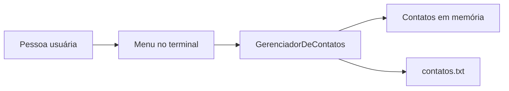

<div align="center">

# 📒 Contact Manager

### Uma agenda em C++ que lembra dos contatos depois que você fecha o programa.

**C++ · Console · Arquivo texto · Jornada Pleno C++ — P2**

</div>

---

## ✨ O que dá para fazer?

| No menu | O que acontece |
| --- | --- |
| ➕ Criar | Cadastra nome, data de nascimento, telefone e e-mail. |
| 📋 Listar | Mostra os contatos disponíveis. |
| 🔎 Buscar | Procura um contato pelo nome. |
| ✏️ Atualizar | Altera um dos campos de um contato encontrado. |
| 🗑️ Remover | Exclui um contato e atualiza o arquivo. |
| 💾 Reabrir | Recupera os contatos salvos em `contatos.txt`. |



## 🚀 Como executar

1. Abra `Contact-Manager.slnx` no Visual Studio com suporte a esse formato de solução.
2. Compile o projeto `Contact-Manager` e execute o programa.
3. Escolha uma opção numérica no menu. O programa procura `contatos.txt` no **diretório de execução**; se ainda não existir, cadastre um contato para criá-lo.

> 💡 A pasta de execução pode ser diferente da pasta onde está `main.cpp`. Se um contato salvo não aparecer ao reabrir, confira onde o executável foi iniciado e onde o arquivo foi gravado.

### Um ciclo rápido para experimentar

```text
1. Criar Contato
2. Listar Contato
3. Buscar Contato
4. Atualizar Contato
5. Remover Contato
0. Sair
```

Cadastre um contato, saia, abra novamente e escolha **Listar**. Esse é o teste mais direto da persistência. Telefone e e-mail podem ficar em branco; nome e data de nascimento não.

## 🧩 Como o projeto está organizado

- **`Contato`** guarda os quatro campos e valida os valores recebidos.
- **`GerenciadorDeContatos`** mantém um `std::vector<Contato>` e concentra as operações do menu e do arquivo.
- **`main()`** apresenta o menu, carrega os registros ao iniciar e encaminha cada escolha.
- **`contatos.txt`** armazena os registros no formato `nome;dataNascimento;telefone;email` e fica fora do Git por meio do `.gitignore`.

O código-fonte atual está em `main.cpp`. Os arquivos `.slnx` e `.vcxproj` configuram a solução do Visual Studio.

## 🛡️ Entradas e arquivo

O caractere `;` separa os campos no arquivo, então não é aceito dentro de um campo. Ao carregar, uma linha com estrutura inválida é informada e ignorada, enquanto as demais continuam sendo processadas. O construtor de `Contato` também valida os dados antes de inserir o registro.

Este projeto usa um arquivo de texto simples. Ele não criptografa os contatos; evite colocar dados sensíveis em uma cópia compartilhada. O arquivo de contatos usado localmente não deve ser enviado ao repositório.

## ✅ Verificações realizadas no P2

Foram relatados como aprovados testes manuais de cadastro, listagem, busca, atualização e remoção; persistência após reiniciar; campos opcionais vazios; linha malformada; nome e data vazios; contato inexistente; e entrada não numérica no menu. **Não há suíte de testes automatizados neste repositório.**

## 🛤️ Na Jornada Pleno C++

Este é o **Projeto 2**, depois do [Task Manager CLI](https://github.com/consultorsandro/Task-Manager-CLI). Ele acrescenta classes, validação de dados e persistência ao trabalho com funções, strings, vetores e menus. O próximo projeto planejado é o **P3 — Personal Finance Manager**.

---

<div align="center">

Feito para transformar uma lista de contatos em um pequeno programa completo. ☕

</div>
